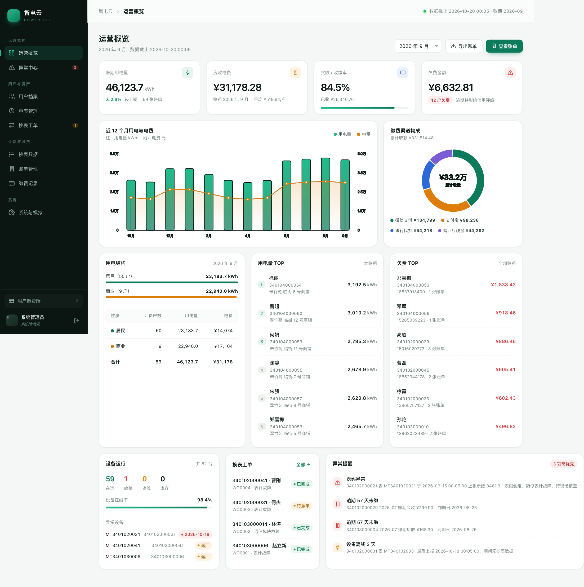
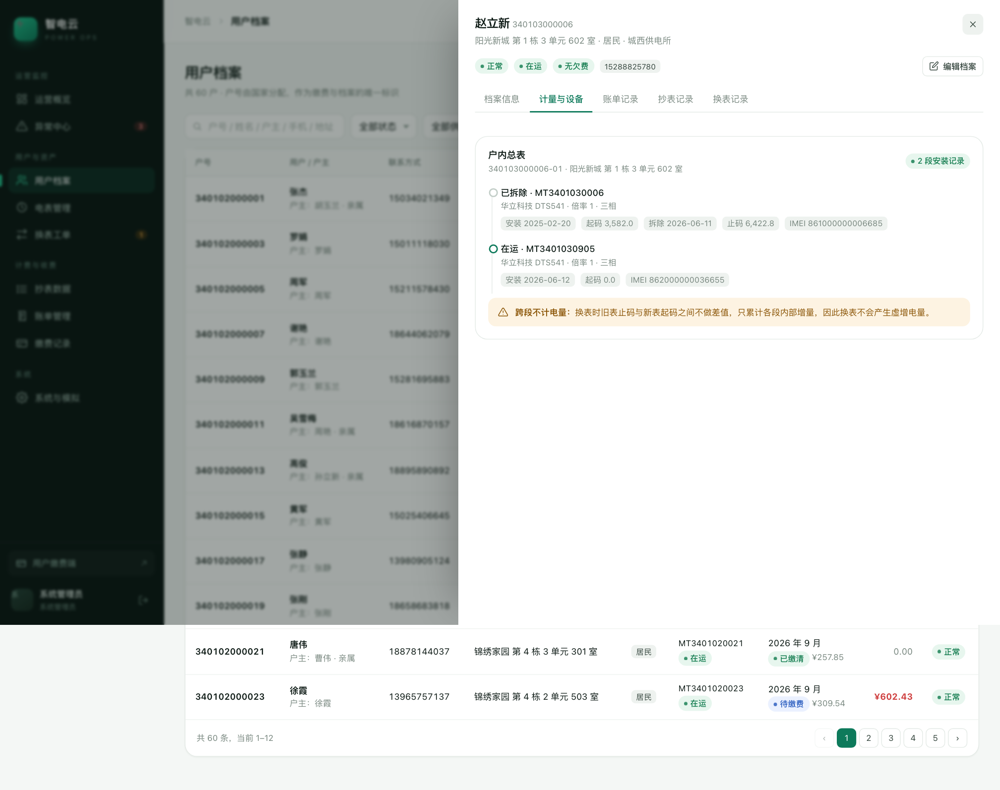
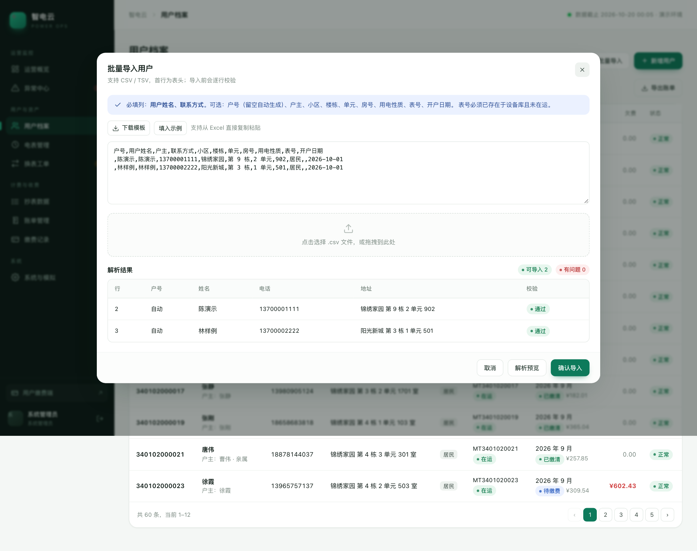
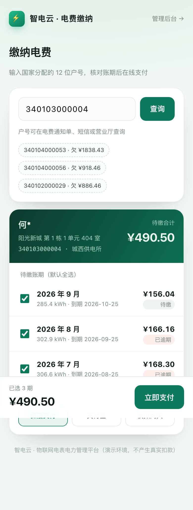

# 智电云 · 物联网电表电力管理系统（演示版）

面向「物联网电表接入 → 户表档案 → 抄表计量 → 出账 → 线上缴费」全链路的可运行演示系统。
零第三方依赖：Node.js 内置 `node:sqlite` + 原生 HTTP，前端为原生 ES Module + 手绘 SVG 图表。



---

## 快速开始

```bash
cd power-admin
node server.js          # 或 npm start
```

- 管理后台：<http://127.0.0.1:4399>
- 用户缴费端：<http://127.0.0.1:4399/pay>
- 演示账号：`admin` / `admin123`

首次启动自动生成演示数据（60 户、13 个账期、2.5 万条日冻结读数、779 张账单、619 笔支付）。
数据文件在 `data/app.db`，删除后重启即可重建；也可在「系统与模拟」里一键重置。

要求 Node.js ≥ 22.5（`node:sqlite`）。无需 `npm install`。

---

## 功能地图

| 模块 | 能力 |
|---|---|
| 运营概览 | 账期 KPI、12 个月用电/电费趋势、缴费渠道构成、用电结构、用电与欠费 TOP、设备运行、换表动态、异常提醒 |
| 用户档案 | 户号/户主/联系方式/地址等全字段档案、计量点与设备时间线、账单/抄表/换表记录、批量导入（CSV）、新增与编辑 |
| 电表管理 | 资产台账、规约/倍率/IMEI/模块号、绑定户、安装历史、新增电表与装表绑定 |
| 换表工单 | 报修 → 审核派单 → 登记完工（拆表止码 / 装表起码）、整表更换与仅换模块两种方案、全程留痕 |
| 抄表数据 | 设备上报与人工补录、数据质量标记、断档清单、历史断档、模拟设备上报 |
| 账单管理 | 按月出账、阶梯电价明细、调整项并入、账单详情与核销记录、导出 CSV |
| 缴费记录 | 支付流水、渠道分布、账单核销明细 |
| 异常中心 | 离线、断档、表码异常、电量突增/骤降、零电量、逾期欠费、换表待办，按严重级别排序 |
| 系统与模拟 | 数据统计、账期运行记录、推进一个月、模拟故障、模拟上报、重置数据 |
| 缴费端 H5 | 户号查询、账单核对、微信/支付宝/模拟网关支付、电子凭证 |

---

## 核心设计：更换电表为什么不丢数据

把「户 → 计量点 → 安装段 → 设备」拆成四层，**读数归属于计量点，设备只是某段时间内服务该计量点的工具**。

```
用电户 340103000006（户号恒定，账单/缴费挂在这里）
└── 计量点 340103000006-01（户内表位，不变）
    ├── 安装段 #1  MT3401030006   2025-02-20 ~ 2026-06-11   倍率 1
    │     起码 3,582.0  →  止码 6,422.8        （表坏，拆表止码）
    └── 安装段 #2  MT3401030905   2026-06-12 ~ 至今          倍率 1
          起码 0.0      →  在运
```

三条规则：

1. **段内**：电量 =（本次示数 − 上次示数）× 倍率；
2. **段间不做差分**：旧表止码 6,422.8 与新表起码 0 之间**不是电量**，直接跳过；
3. **换表当月跨段合并**：两段各自累计后按同一账期合并出账。

实际效果：该户 2026-06 的电量为 366.3 kWh（换表前 20 天 + 换表后 18 天），没有因为换表产生虚增或负值。
在后台「用户档案 → 计量与设备」可以看到这条时间线（见下图）。



### 两种损坏，处理方式不同

| 场景 | 现象 | 处理 | 数据影响 |
|---|---|---|---|
| **常规电表损坏** | 计量停走/乱跳 | 整表更换：登记拆表止码、装表起码，关闭旧段开启新段 | 拆表止码缺失时按日均估算并标记「估抄」，差额走调整项追补 |
| **物联网模块损坏** | 表体走字正常，只是不上报 | 仅换模块：**不产生新安装段**，断开期间现场补录读数 | 读数补上后电量自然连续，无需追补 |

### 数据不可篡改

- `readings` 只追加：修订不覆盖，用 `superseded_by` 指向新记录；质量标记 `suspect` 的数据只告警、不参与计费。
- `bills` 出账后不可改金额：错账、缺数一律通过 `adjustments`（追补/退补）在后续账期处理，账单上能看到并入的调整项。
- 所有关键动作写 `audit_logs`（操作人、时间、对象、明细）。

### 账单与支付解耦

- 一张账单可多次缴（部分缴费），一笔支付可核销多张账单（先清欠费再缴当期）。
- `payments` ↔ `allocations` ↔ `bills` 三段式，任何时点都能回答「这笔钱抵了哪几期」。
- 商户订单号唯一 + `idempotency_key` + 回调幂等，是接真实支付前必须保留的三个约束。

---

## 数据模型

| 表 | 关键字段 | 说明 |
|---|---|---|
| `accounts` | account_no、customer_name、owner_name、phone、address、property_type、status | 户号由国家分配，唯一且不随设备变化 |
| `metering_points` | point_no、account_id | 一个户可有多个表位（总表/分表） |
| `devices` | asset_no、imei、module_no、ratio、phase、status | 设备资产，含库存/在运/故障/返厂/报废 |
| `segments` | point_id、device_id、start/end_date、start/end_reading、ratio | 安装段：换表的核心 |
| `readings` | read_at、reading、source、quality、superseded_by | 只追加，来源含上报/召测/补录/估抄 |
| `bills` | period、usage_kwh、energy_fee、adjustment、total_amount、paid_amount、status | 账期唯一约束，出账幂等 |
| `adjustments` | type、amount、period、status | 待处理项在下次出账时自动并入 |
| `payments` / `allocations` | amount、channel、status / bill_id、amount | 支付与核销 |
| `replacements` | solution、old_final_reading、new_start_reading、status | 工单，也承载止码/起码 |

字段清单见 `db.js` 中的建表语句。

---

## 演示数据里的「剧本」

| 户号 | 用户 | 场景 | 可以看什么 |
|---|---|---|---|
| 340103000006 | 赵立新 | 2026-06-12 表坏换表 | 两个安装段、止码/起码、跨段不计电量 |
| 340103000014 | 林涛 | 2026-07 模块故障 15 天 | 断档、现场补录、电量连续 |
| 340102000031 | 何杰 | 2026-10-18 故障待处理 | 离线告警、换表工单待派单、现场走完工流程 |
| 340102000041 | 曹刚 | 2025-12 历史换表 | 旧表返厂、换表统计 |
| 340103000048 | 韩涛 | 空置房 | 近 30 天零电量告警、该月不出账 |
| 340102000013 | 高俊 | 用电突增 2.6 倍 | 电量突变告警 |
| 340102000021 | 唐伟 | 表码倒走 | 异常读数挂起、不参与计费 |
| 340102000029 等 | — | 逾期 1–3 期 | 欠费 TOP、逾期告警、缴费端补缴 |

> 「系统与模拟 → 模拟推进一个月」会为所有在运表生成下个月日冻结读数并自动出账，
> 换表缺数的待处理调整项（+7.29 元）会并入新一期账单，可以看到完整闭环。

---

## 批量导入

「用户档案 → 批量导入」支持粘贴 Excel 内容或上传 CSV：

```csv
户号,用户姓名,户主,联系方式,小区,楼栋,单元,房号,用电性质,表号,开户日期
340102000901,张小明,张小明,13800001234,锦绣家园,第 1 栋,1 单元,101,居民,MT3401020901,2026-10-01
,李小红,李大强,13900005678,阳光新城,第 2 栋,2 单元,202,居民,,2026-10-01
```

- 户号留空自动按「区域码 + 6 位序号」生成；
- 逐行校验：必填项、手机号格式、户号重复、文件内重复、表号是否存在且未在运；
- 预览页显示「通过 / 有问题」，只导入通过的行；
- 导出的账单 CSV 在「账单管理 → 导出」。



---

## 用户缴费端

移动端优先的 H5，无需登录，凭户号查询。户名脱敏展示，账单默认全选，支持部分账单缴纳、三种模拟渠道，
支付成功后生成含支付单号与账期的电子凭证，后台账单与核销记录实时更新。

<p>

</p>

---

## 目录结构

```
power-admin/
├── server.js            # HTTP 服务、静态资源、路由分发、首次启动播种
├── api.js               # 全部 REST 接口（鉴权、档案、电表、读数、工单、账单、支付、看板）
├── db.js                # SQLite 连接与建表
├── lib/
│   ├── billing.js       # 计量引擎：分段电量、阶梯电价、出账、调整项、支付核销
│   ├── alerts.js        # 异常推导
│   ├── mock.js          # 推进账期、模拟上报、模拟故障
│   ├── seed.js          # 演示数据生成
│   └── util.js
├── public/
│   ├── index.html       # 后台 SPA 外壳 + 图标 sprite
│   ├── app.css          # 设计系统
│   ├── pay.html         # 缴费端
│   └── js/
│       ├── app.js       # 路由、登录、导航
│       ├── core.js      # API 封装、格式化、弹窗/抽屉/表格
│       ├── charts.js    # SVG 图表
│       └── pages/       # 9 个页面
├── data/app.db          # 运行时生成
└── docs/img/            # 截图
```

---

## 接口一览（节选）

```
POST /api/auth/login                 登录
GET  /api/dashboard?period=YYYY-MM   看板
GET  /api/accounts                   用户列表（分页/筛选）
POST /api/accounts                   新增用户
POST /api/accounts/import/preview    导入预校验
POST /api/accounts/import/commit     导入落库
GET  /api/devices                    电表列表
POST /api/devices                    新增电表（可选绑定户）
GET  /api/readings                   抄表记录
POST /api/readings                   人工补录
GET  /api/readings/gaps              断档清单
GET  /api/replacements               换表工单
POST /api/replacements/:id/review    审核
POST /api/replacements/:id/complete  登记完工（关闭旧段/开启新段）
GET  /api/bills                      账单列表
POST /api/bills/issue                按账期出账
GET  /api/bills/:id                  账单明细
GET  /api/payments                   支付流水
GET  /api/alerts                     异常中心
POST /api/system/advance-month       模拟推进一个月
POST /api/mock/iot/push              模拟设备上报
POST /api/mock/fault                 模拟设备故障
GET  /api/public/lookup?accountNo=   缴费端查询
POST /api/public/pay                 缴费端支付
```

---

## 接入真实环境时的改造点

1. **设备接入**：把 `lib/mock.js` 的 `mockPush` 换成 MQTT 订阅（如 `emqx`）或 HTTP 回调，落库逻辑不变；
   建议保留「原始报文表 + 解析后读数表」，便于协议升级后回溯。
2. **支付**：`B.payBills` 之前插入真实下单，回调验签后调用同一核销函数；`idempotency_key` 用商户订单号。
3. **鉴权**：当前为内存会话（重启失效），生产应换 JWT/Redis + RBAC（抄表员、收费员、审核员权限已建角色字段）。
4. **性能**：日冻结 60 户数据量很小；万级户数建议把月度用电做物化汇总表，读数按月分区。
5. **对账**：增加「网关流水 ↔ 支付单 ↔ 账单」三方对账任务，差异进差错池。

## 已知边界

- 未实现阶梯电价按年累计、峰谷分时、滞纳金自动计算（电价结构已用 JSON 保留扩展位）。
- 短信/公众号通知、发票、退款流程未实现。
- 会话存于进程内存，重启后需重新登录。

---

## 部署到线上演示

应用是单进程、零依赖、SQLite 落盘，部署很轻：内存约 60–90 MB，CPU 几乎空闲。
但有三条硬约束，部署前必须知道：

1. **必须挂持久磁盘**（容器内 `/app/data`），否则每次重启/发布都会回到初始演示数据；
2. **只能跑单实例**，登录会话存在进程内存里，多副本会导致「登录后随机掉线」；
3. **对外监听**：`HOST` 已默认 `0.0.0.0`，端口由 `PORT` 控制（默认 4399）。

健康检查：`GET /api/healthz`（无需登录，返回 `{ok,accounts,uptime}`）。
演示保鲜：设置 `DEMO_FRESH=1` 后，服务每 6 小时把在运表的日读数补齐到昨天，
避免演示站放几天没人访问时，所有设备都变成「离线」状态（故障设备不会被补齐）。
管理员密码：首次生成数据时读取环境变量 `ADMIN_PASSWORD`，未设置则为 `admin123`。

### 方式一：Docker（推荐，服务器/托管平台通用）

```bash
docker compose up -d --build          # 首次启动会自动生成演示数据
docker compose logs -f                # 查看日志
```

- 数据在命名卷 `power-data`，重建容器不丢；备份：`docker cp power-admin:/app/data/app.db ./backup.db`
- 反向代理 + 自动 HTTPS + 访问口令：参考 `deploy-Caddyfile`
- 修改管理员密码：`docker compose down && docker volume rm power-admin_power-data`（重置数据）后，
  在 compose 里加 `ADMIN_PASSWORD: 你的密码` 再 `up -d --build`

### 方式二：托管平台（Render / Railway / Fly.io）

适合不想维护服务器：把仓库推到 GitHub，新建 Web Service 选择 Dockerfile，
挂一块 1 GB 磁盘到 `/app/data`，配置 `ADMIN_PASSWORD`，绑定域名即可自动 HTTPS。
免费层通常不提供持久磁盘且会休眠（冷启动 30–60 秒），长期演示建议用最低档付费实例。

### 方式三：临时演示（本机 + 内网穿透）

```bash
node server.js
cloudflared tunnel --url http://localhost:4399   # 或 ngrok http 4399
```

几分钟就能拿到一个公网 HTTPS 地址发给对方，适合评审/客户演示。
缺点是电脑必须开机在线，域名随机，国内访问速度不稳定。

### 上线前检查清单

- [ ] 改掉默认管理员密码（`ADMIN_PASSWORD`）
- [ ] 挂载 `/app/data`，确认重建容器后数据仍在
- [ ] 只开 1 个实例（PaaS 里关掉自动扩缩容）
- [ ] 加访问口令 / IP 白名单，防止演示数据被陌生人重置
- [ ] 国内服务器绑定域名需完成 ICP 备案；香港/海外节点不需要
- [ ] 每天备份一次 `app.db`（SQLite 单文件，直接复制即可）

---

## 两套在线演示（可同时存在）

| | 静态版（GitHub Pages） | 完整版（Render） |
|---|---|---|
| 地址 | `https://<user>.github.io/<repo>/` | `https://power-admin-demo.onrender.com` |
| 成本 | 免费 | 约 $7/月（含 1GB 磁盘） |
| 数据 | 构建时导出的快照 | 实时 SQLite |
| 登录 | 自动进入演示账号 | 真实账号密码 |
| 浏览/筛选/分页 | ✅ | ✅ |
| 缴费 | 浏览器内存模拟，刷新还原 | 真实写库 |
| 新增/导入/出账/换表/推进月份 | ❌ 只读 | ✅ |
| 维护 | 推代码自动重建快照 | 推代码自动部署 |

### 静态版：构建与发布

```bash
node lib/seed.js              # 生成演示数据（CI 里会自动跑）
node scripts/export-static.mjs # 输出 static-site/
cd static-site && python3 -m http.server 4402   # 本地预览 http://localhost:4402
```

发布到 GitHub Pages：

1. 把本项目作为仓库根目录推到 GitHub（`main` 分支）；
2. 仓库 Settings → Pages → Source 选 **Deploy from a branch** → 分支 `gh-pages` / 根目录；
3. 执行 `./scripts/deploy-pages.sh`，会重建快照并推送到 `gh-pages`；
4. 站点地址形如 `https://<user>.github.io/<repo>/`，支持子路径部署。

> 想改成「推 main 自动发布」：把 `deploy/github-pages.workflow.yml` 放回 `.github/workflows/`，
> 并给 GitHub 授权加上 `workflow` 权限（`gh auth refresh -s workflow`），然后在 Pages 里把 Source 切回 GitHub Actions。

> 静态版的数据是构建那一刻的快照。想更新演示数据，改完重新触发一次 workflow 即可。

### 完整版：Render

1. 仓库推到 GitHub；
2. Render 控制台 → **New → Blueprint**，选择本仓库（会自动读取 `render.yaml`）；
3. 按提示填写 `ADMIN_PASSWORD`；
4. 首次部署完成后访问 `https://<service>.onrender.com`。

蓝图里已经配置：Docker 构建、`/app/data` 持久磁盘、健康检查 `/api/healthz`、
`DEMO_FRESH=1` 每天自动补数据（让设备不会一直显示离线）。

> 想先用免费实例试：把 `render.yaml` 里的 `plan: starter` 改成 `free`，并删掉 `disk` 段。
> 代价是每次重启/发布数据重置，且 15 分钟无访问会休眠。
